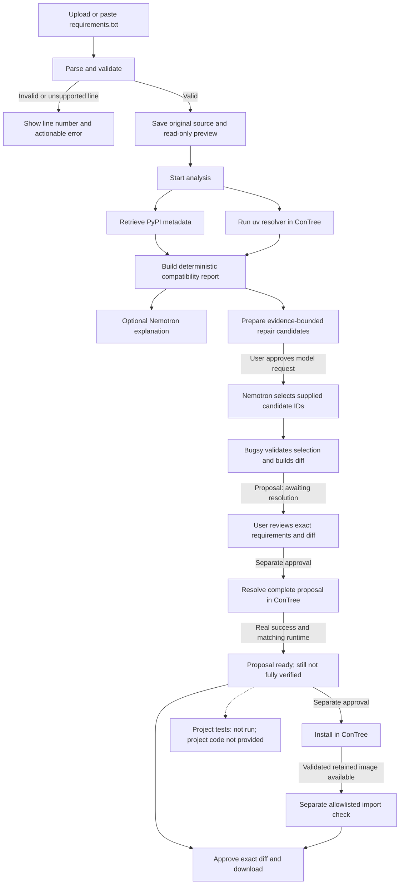
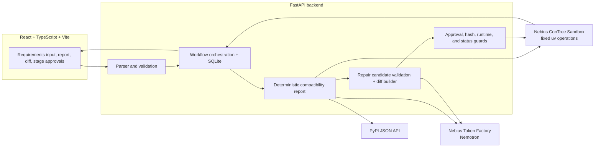

<div align="center">

# Bugsy

### Dependencies, with receipts.

**Turn a Python dependency conflict into an evidence-backed, reviewable repair workflow.**
Bugsy checks what it understood, gathers package facts, asks a real resolver to test a candidate, and keeps every verification stage honest.

[](https://www.python.org/)
[](https://react.dev/)
[](https://nebius.com/)

</div>

> **Demo video:** [Watch on YouTube](https://youtu.be/DIIRniCuikA?si=ejzv08ymqHwtl4eY)<br>
> **Live app:** [Frontend](https://bugsy-l99mh8tjo-romisha-biswas-projects.vercel.app) · [Backend health](https://bugsy-8g9q.onrender.com/health)<br>
> These deployment URLs were previously supplied for the project; their current availability has not been checked for this README.

## The problem

A `requirements.txt` can look simple and still describe a set of packages that cannot coexist. A developer may spend time reading package metadata, guessing which pin to change, and retrying installations in an environment that is different from the eventual deployment.

For example, one pinned package may require `shared-lib<2`, while the same file pins `shared-lib==2.4`. That example illustrates the kind of contradiction Bugsy is designed to investigate; it is not a claim about a particular real package result.

## The solution

Bugsy combines PyPI release metadata with deterministic compatibility reporting and dependency resolution in a Nebius ConTree Sandbox. NVIDIA Nemotron can explain the supplied evidence and select among validated repair candidates. Bugsy builds the proposed file change, shows the diff, and waits for user approval before resolver, installation, import, and download steps.

Bugsy is **not** an autonomous repair agent. A model suggestion is not compatibility evidence, and a successful resolver result does not prove a package installation, import, or application test succeeded.

## Key features

- Upload or paste `requirements.txt` and select a Python target.
- Read-only parse preview with line-specific errors; unsupported or malformed input blocks full analysis.
- PyPI metadata such as `Requires-Python` and `Requires-Dist`, kept distinct from resolver evidence.
- Deterministic compatibility findings and bounded, evidence-grounded Nemotron explanations.
- Repair request preview, candidate validation, and a generated unified diff.
- Separate approval-gated resolver, installation, and import operations in ConTree.
- Persisted proposals, stage history, approval consumption, and operation identifiers in SQLite.
- Explicit `unknown`, `incomplete`, failed, and not-run results; no silent simulated-success fallback.
- Original requirements are preserved. Project tests remain **Not run — project code not provided**.

## How Bugsy works



### System architecture



The browser calls Bugsy’s API; provider credentials remain backend-side. PyPI supplies metadata. The resolver and verification commands run in ConTree, not on the host. The model receives a bounded evidence bundle; deterministic code validates its structured selection and creates the requirements diff. See [`backend/app/api/routes/analyses.py`](backend/app/api/routes/analyses.py), [`backend/app/services/compatibility.py`](backend/app/services/compatibility.py), [`backend/app/services/repair.py`](backend/app/services/repair.py), and [`backend/app/adapters/contree.py`](backend/app/adapters/contree.py).

## Technology stack

| Area | Current implementation |
| --- | --- |
| Frontend | React 19, TypeScript, Vite 6 |
| API | Python 3.12, FastAPI, Pydantic |
| Requirement parsing | `packaging` requirement parser; supported `requirements.txt` syntax only |
| Package facts | PyPI JSON API via `httpx` |
| Resolver | `uv==0.12.19` in the ConTree Sandbox |
| Production Sandbox adapter | `contree-client[httpx]==0.4.1` |
| AI client | OpenAI-compatible Python client for Nebius Token Factory |
| Model default | `nvidia/nemotron-3-super-120b-a12b`, configurable with `NEBIUS_MODEL_ID` |
| Persistence | SQLite at `BUGSY_DATABASE_PATH`, or a system temporary-directory default |
| Tests | pytest, FastAPI TestClient, Vitest, React Testing Library |
| Hosting direction | Vercel frontend + Render backend; optional, not part of the verification evidence |

`backend/pyproject.toml` currently declares both `contree-client[httpx]==0.4.1` and `contree-sdk==0.3.6`. The production adapter uses the client API; the root `test_sandbox.py` is the separate legacy-SDK smoke script.

## AI and agentic architecture

Bugsy uses **NVIDIA Nemotron through Nebius Token Factory** for two bounded assistive tasks: explaining an existing report and selecting among supplied repair candidate IDs. It does not ask the model to invent package versions, rewrite requirement lines, create shell commands, or decide whether compatibility is proven.

The backend supplies candidate release metadata and deterministic findings, validates the model’s structured response against those supplied candidates and supported finding codes, then constructs the proposed requirements text and diff itself. The candidate becomes ready only after a separate real resolver success with a matching Sandbox Python runtime. The deterministic report remains the source of truth; the model’s explanation is optional and can be unavailable without turning an incomplete analysis into a success.

## Nebius integrations

### Token Factory

- OpenAI-compatible API, called from the backend with the configured Nemotron model.
- Used for evidence-grounded report explanations and constrained repair candidate selection.
- `TOKEN_FACTORY_ENABLED` defaults to `false`; `NEBIUS_API_KEY` is never a browser variable.
- The model call requires explicit approval of the sanitized repair-request preview. The response is validated; it does not directly execute code.
- The specification records a historical successful short completion, but the README’s current deployment status says a successful current request is not confirmed. Treat service availability as unverified until a current controlled request succeeds.

### ConTree Sandbox

The production adapter uses `contree-client==0.4.1` with separately submitted and tracked operations, byte-backed file staging, bounded outputs, and explicit retry configuration. It does not guarantee exactly-once execution: an ambiguous submission or tracking result remains unknown and is not automatically resubmitted.

Configure the ConTree base URL as `https://api.tokenfactory.nebius.com/sandboxes`; the SDK manages its `/v1` API paths. The backend uses `NEBIUS_API_KEY` as the bearer credential and sends the separately configured `CONTREE_PROJECT_ID` as the project header. `NEBIUS_API_KEY` is a backend secret, not a browser setting.

Configured targets map as follows, but provider image availability and actual runtime are not confirmed for every target:

| Requested Python | Configured image |
| --- | --- |
| 3.10 | `python:3.10-slim` |
| 3.11 | `python:3.11-slim` |
| 3.12 | `python:3.12-slim` |
| 3.13 | `python:3.13-slim` |
| 3.14 | `python:3.14-slim` |

The adapter checks the actual Sandbox `sys.version` before resolver setup and refuses to report a successful resolution if the runtime is missing, malformed, or does not match the requested target. The application maps the SDK’s resolver output into a result; it does not claim that a downloaded Python distribution means the Sandbox itself runs that version.

### Verification stages and what they prove

| Stage | What it checks | What a pass does not prove |
| --- | --- | --- |
| Dependency resolution | Whether the complete requirements set can be resolved by the pinned `uv` resolver in the reported Sandbox environment. | That submitted packages were installed, imports work, or the user’s application works. |
| Installation | Whether the Sandbox installation operation completed for the proposed requirements. Installation may itself resolve dependencies as part of installing. | That the application imports or its tests pass. |
| Import checks | Fixed, allowlisted imports for direct packages with a reliable distribution-to-module mapping, against a confirmed retained installation image. | That application behavior or project tests pass. |
| Project tests | Not run — project code not provided. | No project-specific test claim is made. |

Installation and import checks are separate approval-gated stages. Import checks require a successful installation with a validated retained image; retention is disabled by default and its cost, lifetime, and availability depend on the provider/account and are not established here.

## Real example: conflict, proposed diff, and actual result

A recorded Bugsy workflow used this original input for Python 3.12:

```text
requests==2.25.0
urllib3==2.2.0
```

The original set was reported as unsatisfiable by the real ConTree resolver. Bugsy then produced and separately checked this candidate proposal:

```diff
-requests==2.25.0
+requests==2.34.2
 urllib3==2.2.0
```

The candidate resolver result passed in ConTree with Python `3.12.13` and `uv==0.12.19`. That is evidence of resolution for that proposed file and environment only. The later installation attempt ended with a transport error and no structured Sandbox result, so its persisted outcome is **unknown**. Imports were not run, and project tests were not run. The example is useful precisely because it shows the boundary between a resolver pass and unconfirmed installation; it is not a fully verified application repair.

## Environment variables

Start from [`.env.example`](.env.example). It contains names/placeholders only; never commit `.env` or put credentials in frontend build variables.

| Variable | Purpose | Default / guidance |
| --- | --- | --- |
| `SANDBOX_ENABLED` | Enables real ConTree operations | `false` |
| `TOKEN_FACTORY_ENABLED` | Enables real Token Factory requests | `false` |
| `SANDBOX_RETAIN_INSTALLATION_ARTIFACT` | Retains a successful install image for a later import-only stage | `false`; retention cost/lifetime/availability are unknown |
| `NEBIUS_API_KEY` | Backend-side Nebius credential | Required for provider calls; do not expose |
| `CONTREE_BASE_URL` | ConTree Sandbox API base URL | Configure in backend environment |
| `CONTREE_PROJECT_ID` | ConTree `Project` header value | Configure separately from the credential |
| `NEBIUS_BASE_URL` | Optional Token Factory API base override | Backend default applies when unset |
| `NEBIUS_MODEL_ID` | Optional Token Factory model override | `nvidia/nemotron-3-super-120b-a12b` |
| `BUGSY_DATABASE_PATH` | SQLite file location | System temporary directory by default; ephemeral on Render Free |
| `CORS_ORIGINS` | Comma-separated allowed browser origins | Local Vite origins by default |
| `VITE_API_BASE_URL` | Browser API base URL, embedded at frontend build time | `http://127.0.0.1:8000`; not a secret |

There is no target-selecting `SANDBOX_IMAGE` override: the image comes from the application-controlled Python target mapping. Request and response limits are application settings, not additional environment variables in `.env.example`.

## Current limitations and unsupported input

- Only uploaded or pasted `requirements.txt` is supported. `pyproject.toml`, lockfiles, local paths, VCS dependencies, editable installs, manual package entry, and other languages are outside the MVP.
- OS-specific markers are evaluated only to the extent supported by the actual resolver environment. Bugsy does not promise cross-platform compatibility.
- Project source and test files are not uploaded. Project tests always remain not run.
- Provider/runtime availability for all five configured Python image tags is unverified.
- Recent live production ConTree file-staging attempts failed with transport errors; the hosted live workflow should not be described as reliable without a new successful, approved run.
- The Token Factory integration is implemented, but current deployment availability is unconfirmed.
- The API currently has no user authentication or application-level rate limiting. Publicly enabling cost-bearing integrations creates abuse and cost risk.
- SQLite defaults to a system temporary directory. On Render Free this is `/tmp/bugsy.sqlite3`, which is writable but ephemeral across restarts/redeploys. A configured mounted persistent disk is needed for durable hosted records; SQLite is a single-instance arrangement.
- The frontend holds the active analysis view in memory; refreshing the page can lose that view even though backend workflow records are persisted.
- The download approval cache is process-local, so a backend restart may require the user to approve the displayed diff again.
- No screenshots are checked into the repository yet; capture them from the actual application before using them in a submission.

## Challenges and lessons

The repository records several practical integration challenges:

- **Uncertain Sandbox transport:** live file staging has failed with transport errors. Bugsy keeps ambiguous outcomes unknown and consumes one-shot approvals rather than automatically resubmitting a potentially non-idempotent operation.
- **Runtime is evidence, not an image label:** a requested Python target or a downloaded interpreter is not enough. Bugsy checks the Sandbox’s actual runtime and blocks a successful resolution claim on mismatch.
- **AI output needs limits and validation:** the spec records a short Nemotron request whose output budget was exhausted before final text. Bugsy validates structured output and rejects missing/incomplete responses rather than equating HTTP success with a usable diagnosis.
- **Deployment storage tradeoffs:** Render Free needs writable temporary SQLite storage, but that storage is ephemeral. Durable SQLite requires an eligible persistent disk and a single backend instance.

The architecture reflects a few useful lessons: package metadata is not a resolver result; resolution is not installation; imports are not application tests; and an explicit unknown result is more useful than an unsupported success claim.

## License

Bugsy is released under the [MIT License](LICENSE).
